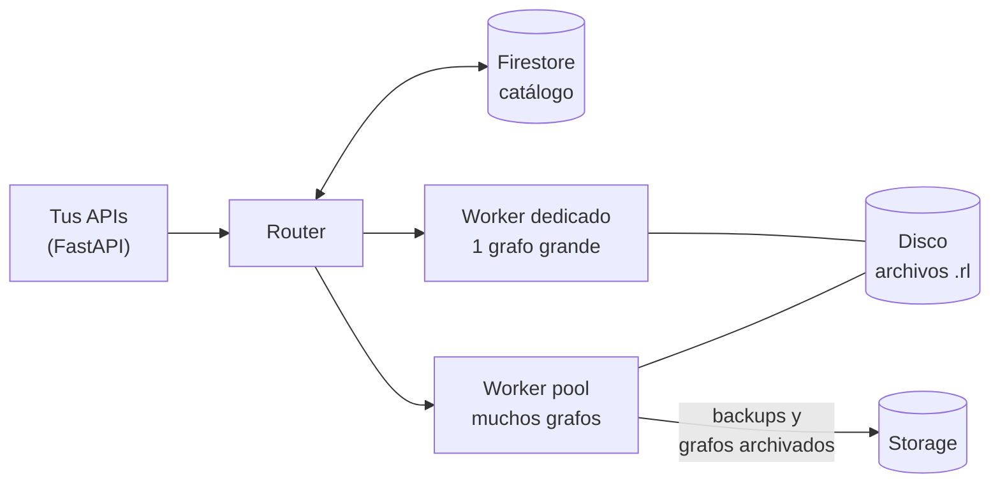
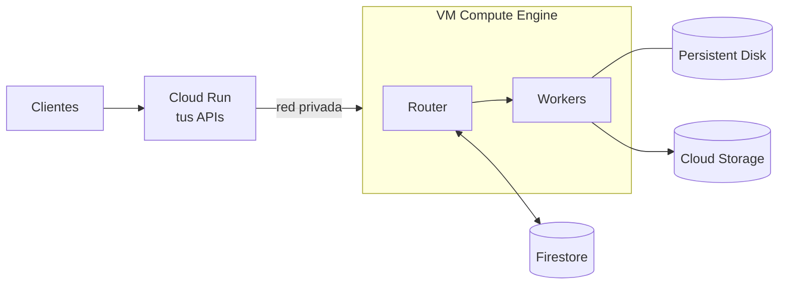

# Arquitectura: plataforma de grafos con Relate
 
Muchos grafos, cada uno guardado en su propio archivo `.rl`, detrás de una sola API.
Los grafos chicos comparten un contenedor. Cuando uno crece mucho, se mueve a su propio contenedor.
 
## Diagrama
 

 
## Las piezas
 
| Pieza | Qué hace |
|---|---|
| **Router** | La única puerta de entrada. Recibe las consultas y las manda al worker que tiene ese grafo. También mueve grafos entre workers. |
| **Catálogo (Firestore)** | Guarda qué worker tiene cada grafo y en qué estado está. |
| **Worker pool** | Un contenedor que tiene abiertos muchos grafos chicos. Cierra los que no se usan para liberar memoria. |
| **Worker dedicado** | Un contenedor para un solo grafo grande, con más memoria. El router lo crea cuando hace falta. |
| **Disco** | Donde viven los archivos `.rl` de los grafos que se están usando. |
| **Storage** | Donde se guardan los backups y los grafos que nadie ha usado en mucho tiempo. |
 
## Cómo funciona
 
- **Consulta:** tu API → router → worker que tiene el grafo → respuesta.
- **Un grafo crece mucho:** el router lo cierra en el pool y lo abre en un contenedor dedicado. No se copian datos: solo cambia qué contenedor abre el archivo.
- **Un grafo no se usa en días:** se sube a Storage y se borra del disco. Si alguien lo vuelve a consultar, se descarga y se abre.
## Reglas importantes
 
1. **Un archivo `.rl` lo abre un solo contenedor a la vez.** Si dos lo abren, se puede dañar.
2. **Los grafos activos van en disco, no en Storage.** Relate necesita escribir pedacitos del archivo todo el tiempo, y Storage solo guarda archivos completos.
3. **El tamaño de un grafo lo limita la RAM**, porque Relate trabaja en memoria.
4. **Cada worker corre con un solo proceso** (`uvicorn --workers 1`), para que no abra el mismo archivo dos veces.
5. **El router no consulta Firestore en cada petición.** Guarda una copia del catálogo en memoria que se actualiza sola.
## En local vs en Google Cloud
 
| Pieza | Local | Google Cloud |
|---|---|---|
| Router y workers | Docker Compose | Una VM de Compute Engine con Docker |
| Disco | Carpeta `./data/graphs` | Persistent Disk pegado a la VM |
| Catálogo | Emulador de Firestore | Firestore |
| Backups y archivados | Emulador de Storage | Cloud Storage |
| Tus APIs | Contenedor local | Cloud Run (se conecta a la VM por red privada) |
| Backups programados | A mano | Cloud Scheduler + Cloud Run Job |
 

 
**Por qué una VM y no Cloud Run para los workers:** el disco de Cloud Run se borra cuando el contenedor se apaga, y los grafos necesitan un disco que sobreviva.
 