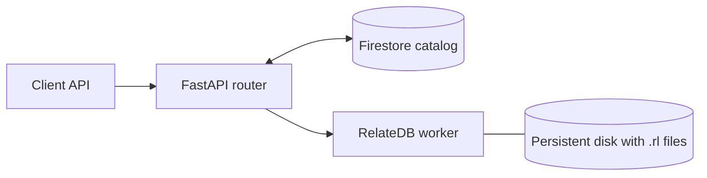

# RelateDB Graph Platform

This project provides a single API for querying multiple RelateDB graphs. Each graph is stored in its own `.rl` file. Keeping those files in a persistent directory lets workers reopen the graphs after a restart.

## Architecture

The FastAPI router uses Firestore to store worker URLs and graph assignments. For each Cypher request, it looks up the assigned worker, asks it to open the graph, forwards the query and any parameters, then attempts to close the graph.

The FastAPI worker resolves each graph ID to a file under `GRAPHS_DIR` and runs operations on each open connection in a dedicated thread. The worker also exposes graph status, file sizes, and process memory usage. Run one Uvicorn server process per worker and assign each graph file to a single worker at a time.



The separation lets clients use a stable API while graph files stay on the disk where workers can reopen and update them. See the [architecture guide](docs/ARCHITECTURE.md) for the planned dedicated workers, backups, and archive storage.

## Local development

Install Python 3.13, `uv`, the Firebase CLI, and Java for the Firestore emulator. Run each service in its own terminal.

### Start Firebase

From the repository root:

```bash
firebase emulators:start --project demo-relate
```

The emulator UI is at `http://localhost:4000`. Firestore listens on port `8080` and Storage on port `9199`.

### Start the worker

From the repository root:

```bash
mkdir -p data/graphs
cd worker
cp -n .env.example .env
```

Set these values in `worker/.env`. `GRAPHS_DIR` is relative to the worker's working directory.

```dotenv
GRAPHS_DIR=../data/graphs
MEMORY_LIMIT_MB=512
MEMORY_THRESHOLD=80
WORKER_ID=worker-1
```

From `worker/`:

```bash
uv run uvicorn src.main:app --workers 1 --env-file .env --reload --port 8001
```

Check `http://localhost:8001/health` for readiness and `http://localhost:8001/v1/graphs/stats` for worker statistics.

### Start the router

From the repository root in another terminal:

```bash
cd router
cp -n .env.example .env
uv run uvicorn src.main:app --workers 1 --env-file .env --reload
```

The template configures the `demo-relate` project and the local Firebase emulator addresses. The router uses port `8000`.

**Known startup issue:** The router currently imports `src.endpoint.v1` in `router/src/main.py`. The package is named `src.endpoints.v1`. Startup requires correcting that import.

### Register and query a graph

Once the router is running, register the worker and assign a graph to it. The registry API spells the project route `registy` and its ID field `projct_id`.

```bash
curl --fail-with-body http://localhost:8000/v1/graphs/registry/worker \
  -H 'Content-Type: application/json' \
  -d '{"worker_id":"worker-1","url":"http://127.0.0.1:8001"}'

curl --fail-with-body http://localhost:8000/v1/graphs/registy/project \
  -H 'Content-Type: application/json' \
  -d '{"projct_id":"demo","worker_id":"worker-1","name":"Demo graph"}'

curl --fail-with-body http://localhost:8000/v1/graphs/query \
  -H 'Content-Type: application/json' \
  -d '{"project_id":"demo","cypher":"RETURN 1 AS number"}'
```

The sample query should return a row with `number` set to `1`. The worker opens `data/graphs/demo.rl` for this graph. Keep that directory across restarts to retain graph data.
