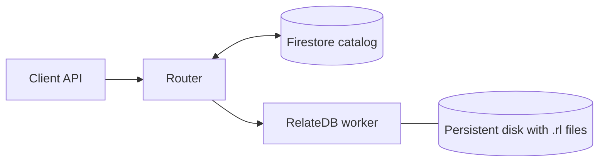

# RelateDB Graph Platform

This project aims to provide a persistent graph database service built on RelateDB. Each graph is stored in its own `.rl` file. Keeping those files in a persistent directory lets a worker reopen the graphs after a restart. Client applications use a single API to run Cypher queries across graphs.

## Architecture

The worker in `worker/` is a FastAPI service that opens and closes RelateDB graphs. It resolves each graph ID to a file under `GRAPHS_DIR` and uses one thread per open graph to run operations on its connection. Run one Uvicorn server process per worker and assign each graph file to a single worker at a time.

The planned router gives clients a single API and uses Firestore as a catalog of graph IDs and worker assignments. A shared worker can serve multiple small graphs. A large graph can move to a dedicated worker with more memory. Active graph files live on disk so workers can reopen them and write updates in place. Cloud Storage is intended for backups and archived graphs.



## Local development

Install Python 3.13, `uv`, the Firebase CLI, and Java for the Firestore emulator.

### Start the Firebase emulators

From the repository root, run:

```bash
firebase emulators:start --project demo-relate
```

The emulator UI is at `http://localhost:4000`. Firestore listens on port `8080` and Storage on port `9199`.

### Configure and start the worker

In a second terminal, run these commands from the repository root:

```bash
mkdir -p data/graphs
cd worker
```

Add this setting to `worker/.env`. The path is relative to the directory where you start the worker.

```dotenv
GRAPHS_DIR=../data/graphs
```

From `worker/`, use this development command:

```bash
uv run uvicorn src.main:app --workers 1 --env-file .env --reload
```

On `main`, worker startup is currently blocked by broken `services` imports and an empty query handler in `worker/src/endpoints/v1/query.py`. Once the worker starts, check `http://localhost:8000/health` and open the interactive API docs at `http://localhost:8000/docs`. The worker accesses graph files directly. The emulators support local development of the Firebase-backed components.
