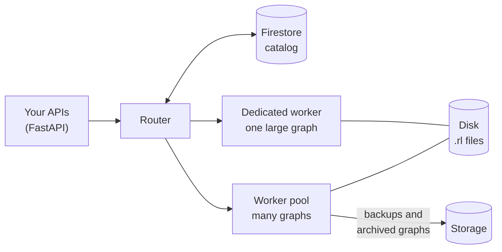
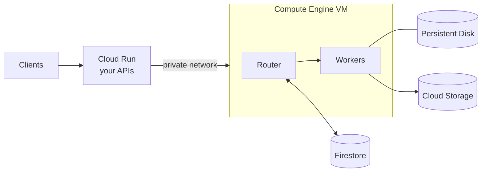

# Architecture: Graph platform with Relate

A single API serves many graphs, each stored in its own `.rl` file.
Small graphs share a container. When a graph grows large enough, it moves to its own container.

## Diagram

## Components

| Component | Role |
|---|---|
| **Router** | The single entry point. It receives queries and forwards them to the worker that holds the requested graph. It also moves graphs between workers. |
| **Catalog (Firestore)** | Tracks which worker holds each graph and the graph's current state. |
| **Worker pool** | A container that keeps multiple small graphs open. It closes idle graphs to free up memory. |
| **Dedicated worker** | A container with more memory for a single large graph. The router creates it as needed. |
| **Disk** | Stores `.rl` files for active graphs. |
| **Storage** | Holds backups and graphs that have been inactive for a long time. |

## How it works

- **Query:** Your API → router → worker that holds the graph → response.
- **A graph grows large:** The router closes it in the pool and opens it in a dedicated container. The same file stays on disk, and only the container that opens it changes.
- **A graph goes unused for days:** The worker uploads it to Storage and deletes it from disk. When another query arrives, the worker downloads and opens it.

## Important rules

1. **Only one container can open a given `.rl` file at a time.** Opening it from two containers can corrupt the file.
2. **Active graphs live on disk.** Relate needs to write small portions of the file frequently, while Storage works with whole files.
3. **Available RAM limits graph size** because Relate operates in memory.
4. **Each worker runs as a single process** (`uvicorn --workers 1`) to avoid opening the same file twice.
5. **The router serves requests using an in-memory copy of the catalog.** The copy updates automatically, so the router can look up graphs without querying Firestore on each request.

## Local vs. Google Cloud

| Component | Local | Google Cloud |
|---|---|---|
| Router and workers | Docker Compose | A Compute Engine VM running Docker |
| Disk | `./data/graphs` directory | Persistent Disk attached to the VM |
| Catalog | Firestore emulator | Firestore |
| Backups and archived graphs | Storage emulator | Cloud Storage |
| Your APIs | Local container | Cloud Run, connected to the VM over a private network |
| Scheduled backups | Manual | Cloud Scheduler + Cloud Run job |

**Why the workers run on a VM:** Graphs need storage that persists after a container stops. Cloud Run's local filesystem is ephemeral.